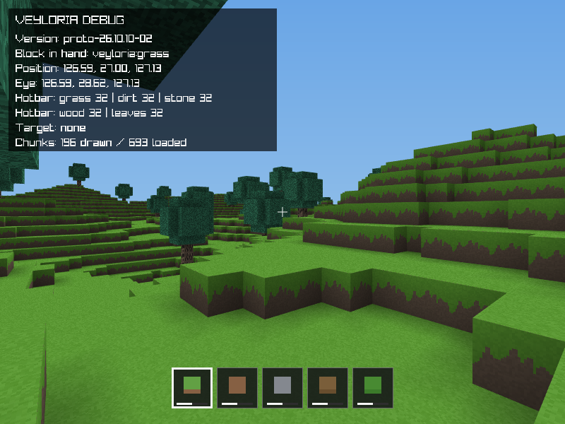

# Veyloria




A small first-person voxel prototype written in C with raylib.

## Build and run

Install a C compiler, Make, and raylib, then run:

```sh
make
./bin/veyloria
```

Run `make test` to build and run the test suites, and `make clean` to remove
build files from `bin/`.

## Controls

- **Main menu:** Click Play, Config, or Exit
- **Config:** Click `<` / `>` to change a setting; Escape returns
- **Escape while playing:** Return to the main menu
- **F11:** Toggle fullscreen
- **WASD:** Move
- **Mouse:** Look around
- **Mouse wheel:** Change hotbar slot
- **Space:** Jump
- **Left Shift:** Sneak (slow, and you cannot walk off edges)
- **Left Ctrl:** Sprint
- **Left mouse button (hold):** Break a block
- **Right mouse button:** Place a block
- **1 – 5:** Select hotbar slot
- **F1:** Toggle debug information
- **F5:** Save the world
- **F9:** Reload the last saved world
- **Escape from the main menu:** Quit

## Documentation

Config offers resolution (640×480 up to 1920×1080), fullscreen, field of view
(60–110), mouse sensitivity, VSync, and master volume. Settings are saved in
`veyloria.cfg`. With VSync on the frame rate is uncapped and synced to the
display; with VSync off it is capped at 60 FPS.

The game defaults to 800×600. Menu images go in `assets/`: `menubg.png` should
be 800×600 and `logo.png` should be 384×192. Both are optional; the menu has a
fallback background and title. The background is center-cropped to fill other
window sizes without stretching.

Each block uses `assets/<name>.png` on every face by default. A face can be
overridden in `blocks.c`, and only the faces you name change:

```c
.texture = {"grass_top", "grass_side", "dirt"},  // top, side, bottom
```

Texture slots are top, side (shared by the four lateral faces), and bottom; an
unset slot falls back to the side texture for the bottom and to the block's
base texture otherwise. If an override file is missing, the base texture is
used. Textures are drawn exactly as authored, with point filtering so pixel art
stays crisp; faces without a texture use the block's `color` instead. Face
corners are darkened by ambient occlusion, and the sky is a vertical gradient.
Grass and wood use these options with generated placeholder art
(`grass_top.png`, `grass_side.png`, `dirt.png`, `wood_top.png`,
`wood_side.png`) — replace those files to restyle the blocks.

New worlds are generated from a seed: rolling hills of grass over dirt and
stone, with scattered trees. The blocks are grass, dirt, stone, wood, and
leaves, and the hotbar has one slot for each. Breaking takes time: hold the
left button and watch the bar under the crosshair — soft blocks like leaves
break quickly while wood and stone take longer.

The world is 256×256×256 blocks stored as sparse 16×16×16 chunks. Only chunks
that contain blocks are allocated, and breaking or placing a block remeshes just
the affected chunk and its bordering neighbours. Chunks outside the camera
frustum are not drawn; F1 shows how many are drawn versus loaded.

The game loads `veyloria-world.sav` on startup and saves automatically on exit.
World data is DEFLATE-compressed and only non-empty chunks are stored. Saves
from older versions cannot be read; on startup such a file is moved to
`veyloria-world.sav.bak` and a fresh world is created.
